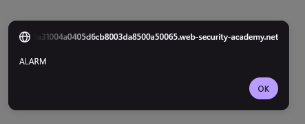

# Reflected XSS into HTML context with nothing encoded

**Severity:**  Medium (reflected XSS needs a victims interaction)

**Location:**  GET / , `search` parameter

**Status:**    Solved

**Lab URL:**   https://portswigger.net/web-security/cross-site-scripting/reflected/lab-html-context-nothing-encoded

## Description

The site's search function reflects the user-supplied `search` parameter directly into the HTML response with no output encoding, allowing arbitrary HTML/JavaScript to be injected and executed in the browser (reflected XSS).

## Steps to Reproduce

1. Submit a normal search term (e.g. `Password`) and observe it reflected verbatim in the response.

   
2. Confirm HTML is rendered, not escaped, by injecting a benign tag: `<b>Password`.

   
3. Inject a payload that executes JavaScript via the `search` parameter:
   `?search=<svg onload=alert("ALARM")>`
   The alert fires, confirming script execution.

   

## Impact

Exploitation requires the attacker to deliver a crafted URL to a victim, who must click it, so it affects only users who open the malicious link. Once triggered, the script runs in the victim's browser within their authenticated session: it can perform any action the user is permitted to, capture credentials entered on the page, or exfiltrate cookies (cookie theft specifically is mitigated by the `HttpOnly` flag). Impact escalates sharply if the victim is an administrator.

## Remediation

Encoding special html characters like `<`, `>`, `"` ... in the websites output, using the appropriate encoding for the context the data is used in (url, attribute, javascript, html body, CSS) causes the browser to render these characters as text and thus neutralizes the injection.

Another defensive measure to use is using the Content- Security Policy header. (CSP). It disallows inline scrips so even if the encoding fails the script is blocked.

## References

- CWE-79: Improper Neutralization of Input During Web Page Generation (Cross-site Scripting)
- OWASP: Cross-Site Scripting (XSS)
- PortSwigger: Reflected XSS
- `https://cheatsheetseries.owasp.org/cheatsheets/Cross_Site_Scripting_Prevention_Cheat_Sheet.html`

## Notes / Learnings

- `alert()` is suppressed in cross-origin iframes on modern Chrome; use `print()` for exploit-server delivery labs (https://portswigger.net/research/alert-is-dead-long-live-print).