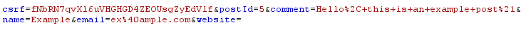
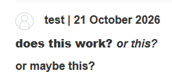

# Stored XSS into HTML context with nothing encoded
 
**Severity:**  High - users visiting the vulnerable page are instantly compromised
**Location:**  Comment functionality
**Status:**    Solved
**Lab URL:**   `https://portswigger.net/web-security/cross-site-scripting/stored/lab-html-context-nothing-encoded`
 
## Description
 
Users can input comments on a blog of the website. This comment functionality is not secured properly against XSS attacks. Thus an attacker can inject code that is then run everytime a user visits that blogpage.
 
## Steps to Reproduce

1. When a comment is posted, a POST request carries the comment data in its body:
    

    The comment is then rendered on the page:
    
    

2. This could be vulnerable to an XSS-attack. The first step to test for it is to input some code that hopefully is executed, like `<b>`.
    ```
    <b> does this work? </b>
    <i> or this? </i>
    <p> or maybe this? </p>
    ```
    shows like this on the website:

    

    This means it is working and the comment section is actually vulnerable to XSS. 
3. To conclude this assignment the alert()-function has to be triggered.
    One way to do it is like this:
    ```
    <script>alert("Alert")</script>
    ```


## Impact
 
This has a way higher impact than the [reflected XSS](01_XSS-reflected-xss-into-html-context-with-nothing-encoded.md) from the lab before. This XSS being stored in the comment section means the injected code will be executed everytime any user visits that specific blog (because that blog includes the comment section). An attacker can easily attack a wide variety of users. He could steal session cookies, credentials, other info belonging to them or even change the website or lure victims to another website that he controls. 
 
## Remediation
 
Encoding special html characters like `<`, `>`, `"` ... in the websites output before the inputted comment is shown to any user defeats this type of XSS attack.
Another defensive measure to use is using the Content-Security-Policy header. (CSP). It disallows inline scripts so even if the encoding fails the script is blocked.

## References
 

- [CWE-79 Cross-site Scripting](https://cwe.mitre.org/data/definitions/79.html)
- [OWASP: Cross-Site Scripting (XSS)](https://community.owasp.org/attacks/xss/)
- [Portswigger XSS Cheatsheet](https://cheatsheetseries.owasp.org/cheatsheets/Cross_Site_Scripting_Prevention_Cheat_Sheet.html)
- [Portswiger stored XSS](https://portswigger.net/web-security/cross-site-scripting/stored)


## Notes / Learnings
 
- stored XSS is way more dangerous than reflected XSS
- stored XSS is also known as persistent XSS or second-order XSS