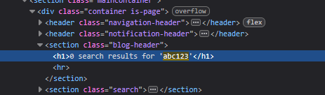
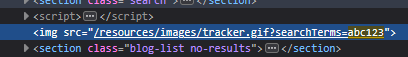
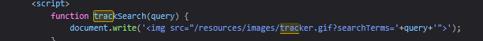
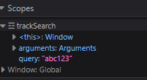
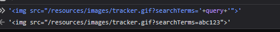
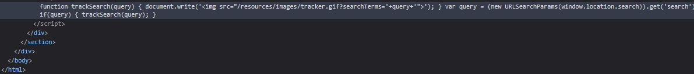
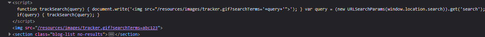

# DOM XSS in document.write sink using source location.search
 
**Severity:**  Medium - The attacker still has to get a victim to use his crafted link

**Location:**  GET / , `search` parameter

**Status:**    Solved

**Lab URL:**   `https://portswigger.net/web-security/cross-site-scripting/dom-based/lab-document-write-sink`
 
## Description
 
The site's search function takes the input of a user and pastes it into an image-attribute inside the javascript without any encoding or security checks. This allows an attacker to inject harmful javascript-code that will be executed by the website.
 
## Steps to Reproduce
 

 
1. The task already mentions the vulnerability being in the serach query tracking functionality. The first step is to check if it works and then input something easily trackable in the code.
When searching for `abc123` the website greets us with the same answer as before and the url paramater search is set to `abc123`.
    Inside the HTML it looks like this:

    
    
    It is also referenced again a bit lower in the code:

    

2. Since the referenced line is `` we know how the whole thing looks in the end.
Using the Debugger tab the dev tools finding the sink is possible looking at the line above. A search for the keywords `tracker` or `searchTerms` should find the sink. 
    

    Setting breakpoint and reloading the page shows us what will be written in the query variable after the breakpoint:

    

    Note, that the searchterm goes directly to the query-variable. There is no encoding or anything happening.
    This can also be verified in the built-in console:

    

    Before continueing here is the Inspector tab where originally `abc123` was found for the second time (I highlighted the crucial part):

    

    Notice that after the script there is nothing in the code.
    After letting the programm continue and finish it looks like this:

    

    This means there is indeed an DOM-based XSS attack happening, input is getting passed to `` without any encoding.

3. It is not possible to simply abuse this by inserting `alert("abc123")` and get an alert. The input ends up inside an img-attribute. So the input needs to break out of this attribute.
This means it needs to start with `">` to end the image attribute. Then `<` starts the crafted payload. Since `alert` is not an attribute we need for example the script-tag to execute it. 

    The whole payload looks then something like this:`">`

    Voila:

    

    This also shows in the url of course which becomes: `https://0ab500f9032e12e181eb706c0042009e.web-security-academy.net/?search=%22%3E%3Cscript%3E+alert%28%22abc123%22%29+%3C%2Fscript%3E` 
    This is the url an attacker would send to a victim.

## Impact

DOM-based XSS has pretty much the same impact a reflected XSS has so the following is the same Impact as in [reflected XSS](01_XSS-reflected-xss-into-html-context-with-nothing-encoded.md)

Exploitation requires the attacker to deliver a crafted URL to a victim, who must click it, so it affects only users who open the malicious link. Once triggered, the script runs in the victim's browser within their authenticated session: it can perform any action the user is permitted to, capture credentials entered on the page, or exfiltrate cookies (cookie theft specifically is mitigated by the `HttpOnly` flag). Impact escalates sharply if the victim is an administrator.

The only difference to an reflected XSS-attack is that, in this case the server does not take part in the attack. Everything that happens, happens in the victims browsers Javascript and thus it is harder to detect.

## Remediation

To defend against DOM-based XSS it is not possible to simply encode on the server side. The only reliable defensive measure is to avoid allowing client supplied data to be dynamically written to the HTML document.
If dynamic writing is required the only reliable way to stop DOM-based XSS is to use a safe sink that always treats input as text like `textContent` or use a client-side sanitiser (DOMPurify) befire it hits an HTML sink.
Output Encoding also works to stop this exploit if it is done in the client-side javascript (before reaching the sink). 
Using the Content-Security-Policy header does not stop the html from being dynamcially changed, but it stops the script from being executed.

## References
 
- [CWE-79 Cross-site Scripting](https://cwe.mitre.org/data/definitions/79.html)
- [OWASP: Cross-Site Scripting (XSS)](https://community.owasp.org/attacks/xss/)
- [Portswigger XSS Cheatsheet](https://cheatsheetseries.owasp.org/cheatsheets/Cross_Site_Scripting_Prevention_Cheat_Sheet.html)
- [Portswigger DOM-based XSS](https://portswigger.net/web-security/cross-site-scripting/dom-based)

## Notes / Learnings
 
- DOM-based XSS is a lot more work to find
- XSS has the same idea of breaking out of attributes as SQLi has for breaking out of queries.
- Searching for attack vectors using an alphanumeric string makes searching for it really easy.