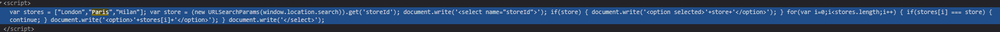
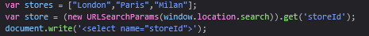
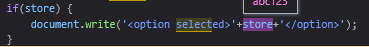
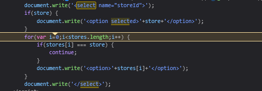
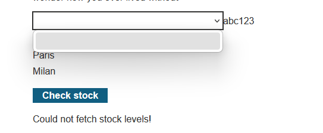
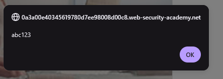

# DOM XSS in document.write sink using source location.search inside a select element
**Severity:**  Medium - The attacker still has to get a victim to use his crafted link

**Location:**  GET /product , `storeId` parameter

**Status:**    Solved

**Lab URL:**   (https://portswigger.net/web-security/cross-site-scripting/dom-based/lab-document-write-sink-inside-select-element)
 
## Description
 
The site's check-stock feature takes the input of a user to determine which locations stock to check. A user can supply any value via url parameters though and it is not checked against. This allows an attacker to inject harmful javascript-code that will be executed by the website.
 
## Steps to Reproduce
 

 
1. The DOM-based XSS again relies on the document.write function but this time the vulnerability is in the stock checker function. The script that actually checks the stock looks like this:
    

    To make it a bit easier to see here the relevant part inside the debugger:

    

    The weird thing here is that the url never takes a `storeId` it stays with only `productid`: `https://0a3a00e40345619780d7ee98008d00c8.web-security-academy.net/product?productId=4`

2. To check if this document.write-function is vulnerable to XSS the first step is to append a storeId to the url, like `&storeId=abc123`. Using a breakpoint and hovering over `.search` it confirms our inputted storeID works:

    

    The document.write-function to be exploited is the following:

    

    The whole function is inside a select-function (between `document.write('<select name="storeId">');` and `document.write('</select>');`):

    

    That means the selectfunction has to be escaped for the exploit to work.

3. Crafting the exploit with that knowledge means it has to start with `</select>`. Using for example `</select>abc123` as an input in the url creates this look on the webpage:

    

    The final payload includes the alertscript again:`</select>`

    

## Impact
 
Same impact as every DOM-based XSS vulnerability. Pasted from [lab 03](03_XSS-dom-xss-in-document.write-sink-using-source-location.search.md).

Exploitation requires the attacker to deliver a crafted URL to a victim, who must click it, so it affects only users who open the malicious link. Once triggered, the script runs in the victim's browser within their authenticated session: it can perform any action the user is permitted to, capture credentials entered on the page, or exfiltrate cookies (cookie theft specifically is mitigated by the `HttpOnly` flag). Impact escalates sharply if the victim is an administrator.

The only difference to an reflected XSS-attack is that, in this case the server does not take part in the attack. Everything that happens, happens in the victims browsers Javascript and thus it is harder to detect.
 
## Remediation
 
Same Remediation as last [lab](03_XSS-dom-xss-in-document.write-sink-using-source-location.search.md).

To defend against DOM-based XSS it is not possible to simply encode on the server side. The only reliable defensive measure is to avoid allowing client supplied data to be dynamically written to the HTML document.
If dynamic writing is required the only reliable way to stop DOM-based XSS is to use a safe sink that always treats input as text like `textContent` or use a client-side sanitiser (DOMPurify) befire it hits an HTML sink.
Output Encoding also works to stop this exploit if it is done in the client-side javascript (before reaching the sink). 
Using the Content-Security-Policy header does not stop the html from being dynamcially changed, but it stops the script from being executed.
 
## References
 
- [CWE-79 Cross-site Scripting](https://cwe.mitre.org/data/definitions/79.html)
- [OWASP: Cross-Site Scripting (XSS)](https://community.owasp.org/attacks/xss/)
- [Portswigger XSS Cheatsheet](https://cheatsheetseries.owasp.org/cheatsheets/Cross_Site_Scripting_Prevention_Cheat_Sheet.html)
- [Portswigger DOM-based XSS](https://portswigger.net/web-security/cross-site-scripting/dom-based)

## Notes / Learnings
 
- escaping is context dependant, here it was closing the `<select>` element, not an attribute