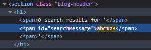
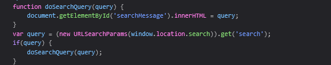
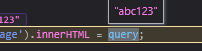
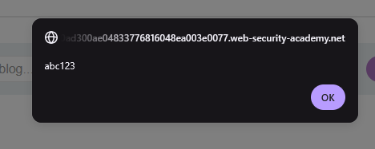

# DOM XSS in innerHTML sink using source location.search
**Severity:**  Medium - The attacker still has to get a victim to use his crafted link

**Location:**  GET / , `search` parameter

**Status:**    Solved

**Lab URL:**   (https://portswigger.net/web-security/cross-site-scripting/dom-based/lab-innerhtml-sink)
 
## Description
 
The site's search-blog feature takes the input of a user to find a user-supplied string. A user can supply any values though and it is not checked against. This allows an attacker to inject harmful javascript-code that will be executed by the website.
 
## Steps to Reproduce

 
1. The search-blog functionality is vulnerable to DOM-based XSS here. Searching for `<b> Password` confirms this. After searching for the known `abc123` string this is how the html of the page stores it:

    

2. Looking at the source file in the debugger (looking for keywords like `query`) this line shows the `innerhtml`-sink mentioned in the labs description.

    

    And query becomes `abc123` as expected:

    

    Since `innerHTML` does not accept `<script>` elements nor `svg onload` events, alternative elements need to be used. One of these is ``. This can be combined with the `onload` / `onerror`-eventhandler attributes. 

3. One possible way to trigger this XSS-vulnerability is: ``:

    
 
## Impact
 
Same impact as every DOM-based XSS vulnerability. Pasted from [lab 03](03_XSS-dom-xss-in-document.write-sink-using-source-location.search.md).

Exploitation requires the attacker to deliver a crafted URL to a victim, who must click it, so it affects only users who open the malicious link. Once triggered, the script runs in the victim's browser within their authenticated session: it can perform any action the user is permitted to, capture credentials entered on the page, or exfiltrate cookies (cookie theft specifically is mitigated by the `HttpOnly` flag). Impact escalates sharply if the victim is an administrator.

The only difference to an reflected XSS-attack is that, in this case the server does not take part in the attack. Everything that happens, happens in the victims browsers Javascript and thus it is harder to detect.

## Remediation
 
Same Remediation as [lab3](03_XSS-dom-xss-in-document.write-sink-using-source-location.search.md).

To defend against DOM-based XSS it is not possible to simply encode on the server side. The only reliable defensive measure is to avoid allowing client supplied data to be dynamically written to the HTML document.
If dynamic writing is required the only reliable way to stop DOM-based XSS is to use a safe sink that always treats input as text like `textContent` or use a client-side sanitiser (DOMPurify) befire it hits an HTML sink.
Output Encoding also works to stop this exploit if it is done in the client-side javascript (before reaching the sink). 
Using the Content-Security-Policy header does not stop the html from being dynamcially changed, but it stops the script from being executed.
 
## References
 
- [CWE-79 Cross-site Scripting](https://cwe.mitre.org/data/definitions/79.html)
- [OWASP: Cross-Site Scripting (XSS)](https://community.owasp.org/attacks/xss/)
- [Portswigger XSS Cheatsheet](https://cheatsheetseries.owasp.org/cheatsheets/Cross_Site_Scripting_Prevention_Cheat_Sheet.html)
- [Portswigger DOM-based XSS](https://portswigger.net/web-security/cross-site-scripting/dom-based)

## Notes / Learnings

- `innerHTML` -> `script` / `svg onload` don't work. `` or `iframe` combined with `onload` / `onerror` works