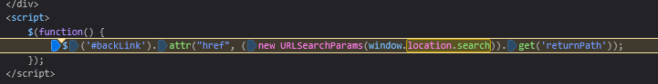
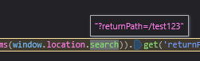

# DOM XSS in jQuery anchor href attribute sink using location.search source
 
**Severity:**   Medium - The attacker still has to get a victim to use his crafted link

**Location:**  GET /feedback , returnPath

**Status:**    Solved

**Lab URL:**   (https://portswigger.net/web-security/cross-site-scripting/dom-based/lab-jquery-href-attribute-sink)
 
## Description
 
The site's submit-feedback feature takes the input of a user. This user can supply any values through the url path though and it is not checked against. This allows an attacker to inject harmful javascript-code that will be executed by the website.
 
## Steps to Reproduce
 

 
1. Going into the browsers debugger, looking for `location.search` shows the following:

This is also exactly the vulnerable line.
2. Setting a breakpoint here, changing the url path to `?returnPath=/test123` and running the program shows that the path is indeed shown in that line:

3. Using the suggested string from the lab `?returnPath=javascript:alert(document.domain)` (replace `url` with `Path`) instead solves it.
This works because `window.location.search` takes the user supplied path and set the backlinks `href` attribute to exactly that path. `href` allows the execution of code so the user supplied javascript code is executed. `javascript:` is a URI scheme to run javascript code like `tel:` is to dial a telephone number or `mailto` to open an email app.

Just to check changing the url to `...?returnPath=javascript:alert("hello")` and clicking on `back` in the bottom of the screen shows the alert:

## Impact
 
Same impact as every DOM-based XSS vulnerability. Pasted from [lab 03](03_XSS-dom-xss-in-document.write-sink-using-source-location.search.md).

Exploitation requires the attacker to deliver a crafted URL to a victim, who must click it, so it affects only users who open the malicious link. Once triggered, the script runs in the victim's browser within their authenticated session: it can perform any action the user is permitted to, capture credentials entered on the page, or exfiltrate cookies (cookie theft specifically is mitigated by the `HttpOnly` flag). Impact escalates sharply if the victim is an administrator.

The only difference to an reflected XSS-attack is that, in this case the server does not take part in the attack. Everything that happens, happens in the victims browsers Javascript and thus it is harder to detect.

## Remediation
 
To defend against this DOM the website needs to validate the URI-scheme and only accept `http:` or `https:` or relative paths. That way it rejects the `javascript` scheme and is secured.

## References
 
- [CWE-79 Cross-site Scripting](https://cwe.mitre.org/data/definitions/79.html)
- [OWASP: Cross-Site Scripting (XSS)](https://community.owasp.org/attacks/xss/)
- [Portswigger XSS Cheatsheet](https://cheatsheetseries.owasp.org/cheatsheets/Cross_Site_Scripting_Prevention_Cheat_Sheet.html)
- [Portswigger DOM-based XSS](https://portswigger.net/web-security/cross-site-scripting/dom-based)

## Notes / Learnings
 
- the sink decides how the whole attack works
- `javascript:` is a URI-Scheme that executes code. `data:` scheme is also dangerous.
