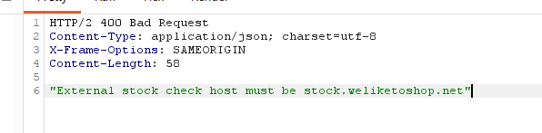
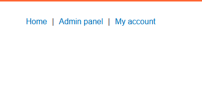

# SSRF with whitelist-based input filter
**Category:** Web Exploitation — SSRF
**Difficulty:** Expert
**Progress:** Solved

---

## Description

**Lab URL:** `https://portswigger.net/web-security/ssrf/lab-ssrf-with-whitelist-filter`

This lab has a stock check feature which fetches data from an internal system.
To solve the lab, change the stock check URL to access the admin interface at http://localhost/admin and delete the user carlos.
The developer has deployed an anti-SSRF defense you will need to bypass. 

---

## Reconnaissance

- What does the application do? 
    - The website is a shop. There is a stock-check feature
- Where is user input accepted? (forms, URL parameters, headers, cookies)
    - No direct user input, only in the request itself
- What happens with normal input?
    - The stock of an item at a certain location is given back

---

## Analysis


#### Vulnerability

The app takes an url from user input (stockApi) and fetches it server-side. This time there is an input filter which has to be circumvented.

---

## Solution 

### Step 1 - Recon / Looking at responses


The line to change is `stockApi=http://stock.weliketoshop.net:8080/product/stock/check?productId=3&storeId=1`, just replacing the url with `http://localhost/admin` gives back an error message:


This tells us we gotta get through a verification process that uses a whitelist and only accepts the host: `stock.weliketoshop.net`
So `stockApi=http://stock.weliketoshop.net/admin?productId=3&storeId=1` should atleast give a response. And indeed it gives a different error message and returns HTTP 500. The error message is: Could not connect to external stock check service
This is different from the other error. This time the external stock check is `stock.weliketoshop.net` but it can not connect to it because of the path `/admin`
Trying to embed credentials:

`stockApi=http://stock.weliketoshop.net@localhost?productId=3&storeId=1` would mean that the request actually goes to localhost, and `stock.weliketoshop.net` is interpreted as a username. 
This again returns the error message: "External stock check host must be stock.weliketoshop.net". This seems to work, the verification tool takes whatever comes after `@` and uses it as a host. So if we swap it around the error should be gone. And indeed `stockApi=http://localhost@stock.weliketoshop.net` gives the known 500 Internal Server Error.
Remember the goal: get through the check and let the server behind it just interpret and use our supplied localhost as a base.

Right now we are through the check. Our inpuit is decoded once (remember in the beginning the whole url was URL-encoded once.) and then the host is checked which in the current state is `stock.weliketoshop.net`. 
So the next step is to abuse the decoding step from the server that happens AFTER the verification and use that to change the host to our localhost.
To do that `#` is used. 
The current line is `stockApi=http://localhost@stock.weliketoshop.net` adding `#` after localhost would make localhost the actual host and everything after it becomes an URL-fragment and is ignored. 
That means if we add `#` after localhost and URL-encode it once it becomes: `http://localhost%23@stock.weliketoshop.net` now the verification tool decodes it back to `http://localhost#@stock.weliketoshop.net` and because everything after `#` is treated as a fragment and localhost is treated as a host the tool denies us, because it only let's `stock.weliketoshop.net` as a host go through.
If we encode `#` a second time we get: `http://localhost%2523@stock.weliketoshop.net`. Now the verifier againd decodes once: and reads: `http://localhost%23@stock.weliketoshop.net` this has no `#` so the effect of `#` is not happening. `@` is working though and so the tool reads `stock.weliketoshop.net` as the host and `localhost%23` as a username.
Now the server in the backend takes this `http://localhost%23@stock.weliketoshop.net` as an input and decodes it again getting `http://localhost#@stock.weliketoshop.net` which makes the server read `localhost` as the host and everything after `#` as a url fragment.
And this returns a HTTP 200 so it works.
Opening it in the browser there is also the admin panel showing (as seen in the response):


---
### Step 2 - Enumeration / Exploitation

The only thing missing now is adding the path that deletes carlos account.
Looking at the general URL structure:
```
scheme :// [userinfo @] host [:port] / path ? query # fragment
           └──────── authority ───────┘└──── everything else ────┘
```
it is clear where our path has to go. The first `/` is what starts the path and if we placed it right after `localhost` it would signal to the verifier that whatever comes before it is the host. That means it has to at the very end after `stock.weliketoshop.net` and thus complete the authority part of the url. 
That means first we add `/admin` and then in the next step `/admin/delete?username=carlos` and carlos account is deleted and the lab solved.

Small note:
This only works because the parser here is a bit weird. In reality everything after `#` is treated as a fragment, including the supplied `/` and the path behind it. 

---
## Real World Impact

Abusing this vulnerability an attacker can reach internal services (admin panels, databases) and in the process steal credentials or API-Keys. 
He could also map the internal server using the server as a proxy.

---
## Learnings
URL-structure:
```
scheme :// [userinfo @] host [:port] / path ? query # fragment
           └──────── authority ───────┘└──── everything else ────┘
```

Note: Everything between `://` and the first of `/`, `?` or `#` is the authority. 
```
http://host/admin           → authority = host,  then path  /admin
http://host?x=1             → authority = host,  then query ?x=1   (no path)
http://host#section         → authority = host,  then fragment #section (no path)
```
That is why the early `#` was a problem at first. `http://localhost#@stock.weliketoshop.net` cuts the host off right before `#` and thus the verifier reads `localhost` as the host and denies it.

- always think step by step: if there is a filter get through it first and then to the server - they are SEPERATE that is why double encoding works