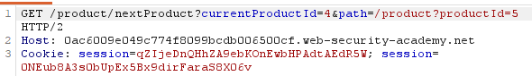
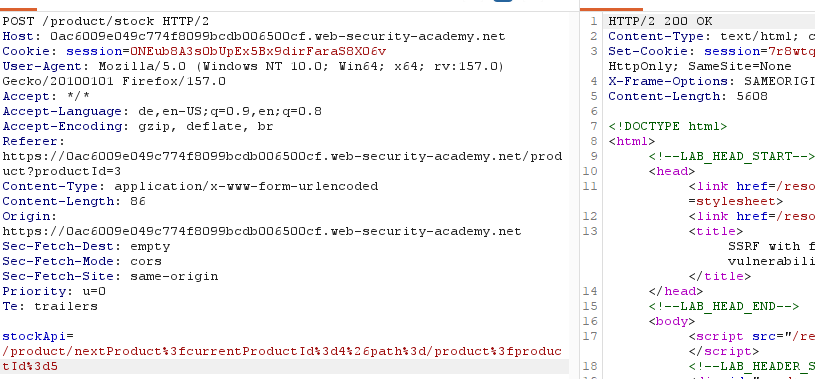

# SSRF with filter bypass via open redirection vulnerability
**Category:** Web Exploitation — SSRF
**Difficulty:** Expert
**Progress:** Solved

---

## Description

**Lab URL:** `https://portswigger.net/web-security/ssrf/lab-ssrf-filter-bypass-via-open-redirection`

This lab has a stock check feature which fetches data from an internal system.
To solve the lab, change the stock check URL to access the admin interface at http://192.168.0.12:8080/admin and delete the user carlos.
The stock checker has been restricted to only access the local application, so you will need to find an open redirect affecting the application first. 

---

## Reconnaissance

- What does the application do? 
    - The website is a shop. There is a stock-check feature, there now is a new button to get to the next product below every product
- Where is user input accepted? (forms, URL parameters, headers, cookies)
    - No direct user input, only in the request itself
- What happens with normal input?
    - The stock of an item at a certain location is given back

---

## Analysis

#### Vulnerability

The app takes an url from user input (stockApi) and fetches it server-side. `StockApi` can not point to a foreign host so an open redirect needs to be used which is supplied by the new functionality: `/product/nextProduct?path=`

---

## Solution 

### Step 1 - Recon / Looking at responses

New functionality lets take a look:

Requesting `/product/nextProduct?currentProductId=3&path=/product?productId=5` returns `HTTP/2 302 Found` with a location header being the path we supplied. This indicates that this is a usable redirection. (3xx status + location that echoes our input)

This has exactly the `path`-paramter needed for a redirection. Let's see if this can be fed into `stockApi` (which is known to be vulnerable to SSRF). Note: we can not just change the GET-request because we come from outside the network and won't be able to get through the firwall to the local ip.

This seems to work well.

---
### Step 2 - Enumeration / Exploitation

Changing the path to `http://192.168.0.12:8080/admin` as instructed returns the admin panel. So using `http://192.168.0.12:8080/admin/delete?username=carlos` for path deletes carlos and solves the lab
Final line was: `/product/nextProduct?path=http://192.168.0.12:8080/admin/delete?username=carlos`

---
## Real World Impact

Abusing this vulnerability an attacker can reach internal services (admin panels, databases) and in the process steal credentials or API-Keys. 
He could also map the internal server using the server as a proxy.

---
## Learnings

- Watch out for requests with paramters that include urls. If they return a `3xx`-response with a location header that reflects the input it is a good sign for open redirect.
- the redirect target must be absolute not relative.
- redirect has to be done through ssrf sink because outside requests to internal hosts is blocked
- 302 response means "not here — go to this other URL instead," and the new URL is in the Location: header.